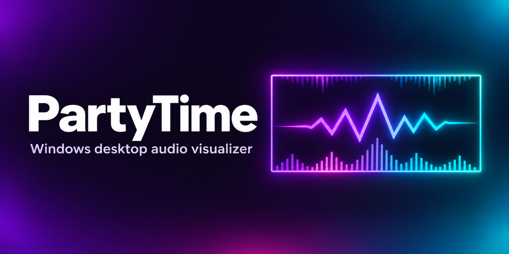

# PartyTime



PartyTime is a C#/.NET 10 Windows desktop visualizer. It listens to the mix on your default Windows playback device using WASAPI loopback and animates a click-through overlay on each display.

## Run

Open `PartyTime.exe` from the publish folder, or run this from the project directory with the .NET 10 SDK installed.

```powershell
dotnet run --project PartyTime.csproj
```

1. Play music or a video through your default Windows output.
2. Click **Start party** or press **Ctrl + Alt + P**.
3. Use **Visuals**, **Audio**, and **Colors** to change the effect. The style preview uses sample motion so you can see changes with the overlay off.
4. Use the same shortcut to stop. Closing the controls sends them to the notification area. Right-click the PartyTime icon and choose **Exit PartyTime** to quit. Your choices are saved locally.

In **App**, turn on **Start with Windows** to launch PartyTime in the system tray when you sign in. It is off by default. If you move the executable, toggle the setting off and back on from the new location.

## Customize

- **Visuals** offers Edge Bars, Orbit, Center Bars, and Wave. Choose **None** with **Edge glow and beat ripple** enabled for a border-only effect. Adjust size and intensity to taste.
- **Audio** offers Full Mix, Bass, Vocals, Mids, Treble, and a custom range from 40 to 13,000 Hz. The selected frequencies drive the spectrum and the beat effects. Vocals emphasizes the 300–3,400 Hz range. Use **Response** to change how strongly the visuals move.
- **Colors** offers Neon, Sunset, Aurora, and a custom two-color palette. Click a swatch to pick a color, or enter its hex code. **Screen** samples your primary display, and **Mix** lets you blend those colors with a palette.

**Cycle through colors** is on by default. It moves the current colors through the overlay and shifts them forward on beats. The visuals react to music either way, and screen colors still update in Screen or Mix mode when sampling is active.

Screen colors are sampled locally while the party is on in Screen or Mix mode. The sampler excludes PartyTime's overlay to prevent color feedback, so the effect can be hidden from Windows screenshots and screen recordings in those modes. Use Palette mode to keep it visible in captures.

The overlay covers each connected display and passes clicks through to your apps. It fades during silence and reconnects when the default playback device changes. Audio samples are analyzed in memory.

PartyTime runs over the normal desktop, including browser fullscreen and borderless fullscreen windows. Exclusive fullscreen applications and the Windows secure desktop can bypass desktop overlays. Audio routed to another playback device is outside the captured mix.

## Project layout

| Folder | Responsibility |
| --- | --- |
| `Views/` | WPF windows and their code-behind |
| `Controls/` | The live style preview control |
| `Audio/` | System audio capture, frequency analysis, and audio data types |
| `Visualization/` | Overlay windows, effect rendering, and screen color sampling |
| `Settings/` | Visualizer preferences and local persistence |
| `Interop/` | Win32 window placement, capture exclusion, the global hotkey, and Windows startup registration |
| `Assets/` | App icons and project artwork |

## Publish

```powershell
dotnet publish -c Release -r win-x64 --self-contained false -p:PublishSingleFile=true -p:DebugType=None -o artifacts/win-x64
```

The published executable requires the .NET 10 Desktop Runtime for Windows x64.

## License

PartyTime by [Jihad Khawaja](https://github.com/jihadkhawaja) is released under the [MIT License](LICENSE).
