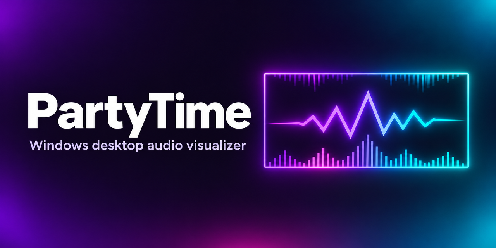

# PartyTime

**A beat-synced desktop visualizer built with Avalonia and .NET 10 for Windows, Linux, and macOS.**



PartyTime turns music, videos, and other system playback into a light show across your displays. Transparent overlays pass clicks through to your apps, respond to independent audio ranges, and fade during silence. The controls, preview, image tools, and effects use Avalonia and its Skia renderer on every platform.

## Platform requirements

| Platform | Playback capture | Desktop integration |
| --- | --- | --- |
| Windows 10 / 11 | WASAPI loopback on the default output; reconnects when the output changes | Click-through overlays, tray, global shortcut, startup registration; screen effects require Windows 10 version 2004 or later and capture exclusion support |
| Linux with X11 and a compositor | `parec` from `pulseaudio-utils`, connected to PulseAudio or PipeWire-Pulse; captures the default output monitor | Click-through X11 overlays, cursor tracking, shortcut, XDG autostart, and tray where a host exists; closing controls quits so the app remains usable without a tray host |
| macOS 13 or later | Native ScreenCaptureKit helper captures system playback without a virtual audio device | Click-through overlays, menu-bar controls, LaunchAgent startup, and screen effects; allow Screen & System Audio Recording when macOS requests it; the global shortcut may also need Input Monitoring permission |

**Linux limitations:** use an X11 desktop session for global overlay placement and cursor tracking. XWayland behavior depends on the compositor; native Wayland does not expose the global placement and input APIs this app requires. Screen color sampling and screenshot effects are unavailable on Linux because the current capture backend cannot exclude PartyTime safely. These controls explain the limitation; palette effects, audio routing, imported images, and motion continue working.

On Ubuntu / Debian, install Linux playback capture with `sudo apt install pulseaudio-utils`. A PipeWire desktop must also provide its PulseAudio compatibility server. A compositing window manager is required for transparent X11 overlays.

macOS builds require Xcode Command Line Tools (`xcode-select --install`) to compile the included Swift helper. Published macOS bundles include the helper; end users do not need Swift or the .NET SDK. macOS packages are ad-hoc signed, and are not Developer ID signed or notarized.

## Run from source

Install the .NET 10 SDK, plus the requirements above for your OS.

```sh
git clone https://github.com/jihadkhawaja/PartyTime.git
cd PartyTime
dotnet run --project PartyTime.csproj
```

1. Play music or a video through your default audio output.
2. Click **Start party**, or press **Ctrl + Alt + P** (**Ctrl + Option + P** on macOS).
3. Choose a preset in **Visuals** and click **Apply preset**, or mix individual layers. The preview uses sample motion even with the overlay off.
4. Use **Stop party** to clear the overlay. On Windows and macOS, closing controls sends the app to the tray / menu bar; choose **Exit PartyTime** to quit. On Linux, closing controls quits.

Launching PartyTime again opens the existing instance's controls. Startup launches use `--startup`; Windows and macOS open in the tray / menu bar, while Linux keeps controls visible.

## Customize

| Tab | Controls |
| --- | --- |
| **Visuals** | Eight visual presets; bars and waves, circles, borders, overlay effects, size, intensity, 20 / 30 / 45 / 60 FPS, and Match display |
| **Images** | PNG, JPEG, and BMP stickers, image halos, floating images, and dot / spark replacements; individual size, opacity, copies, placement, audio routing, and chroma key |
| **Screen** | Beat-synced screenshots, blend mode, beat source, beats per screenshot, opacity, zoom, and fade time, on supported platforms |
| **Motion** | Glow, ribbon, or shape cursor trails; ten animated shape types plus mixed shapes; float, orbit, rain, burst, and spiral motion |
| **Audio** | Full mix, bass, vocals, mids, treble, or custom frequency focus, response, and independent ranges per layer |
| **Colors** | Neon, Sunset, Aurora, or two custom colors; palette, screen sampling, or a blend; optional color cycling |
| **App** | Start at sign-in, off by default |

Each visual layer has a **None** option. Border-only, image-only, shape-only, and cursor-only looks work independently. Cursor trails also work during silence. Trail lifetime ranges from 150 to 2,000 ms; motion history clears when disabled. Animated shapes include circles, squares, triangles, diamonds, stars, hexagons, hearts, crosses, pentagons, and octagons, with 4–96 shapes and filled or outlined styling.

Audio ranges are **Low** (40–250 Hz), **Mid** (250–2,000 Hz), **High** (2,000–13,000 Hz), **Full mix**, and **Follow focus**. Vocals emphasizes 300–3,400 Hz. Each layer's routing works independently of the global focus. Presets preserve imported images, audio focus, response, frame rate, and screenshot preferences.

Buttons use consistent padding and clear primary, secondary, and destructive styles. Radio choices are full selection cards with a checkmark, selected styling, hover feedback, and keyboard focus indicators. Native radio grouping and keyboard interaction remain available.

### Images

Add up to 16 images with up to 64 copies each. Transparency and aspect ratio are preserved. Imported copies are kept in PartyTime's local data folder, so moving the original image does not break the overlay. Images must be under 20 MB and no larger than 16,384 pixels per side; copies are scaled to at most 1,024 pixels on the longer side.

Use Ctrl+click (Command / platform selection modifiers where supported), Shift+click, or **Select all** for bulk edits. A change applies only that field to selected images, preserving individual values elsewhere. Mixed values are marked, and the preview shows the first selected image. Image names remain individual.

**Remove a color (chroma key)** removes an opaque background while preserving the original. Choose **Pick from image** and click the original preview, or enter a hex color. Tolerance removes similar shades with feathered edges; the checkerboard shows transparency. Disabling chroma key restores the original.

Shared halos and floating layouts interleave images in list order, reserve separate slots, and shrink copies to avoid overlap. Stickers sharing an anchor are placed side by side; separately positioned stickers retain their anchors.

### Screen effects

On Windows and macOS, screen colors are sampled from the primary display. Screenshots are captured per display, held for 1–8 beats, and faded over 150–2,000 ms. Intermediate beats renew opacity and zoom; 0% zoom keeps the screenshot still. **Normal**, **Additive**, **Screen**, **Multiply**, **Difference**, and **Negative** blends are available. The Screen tab previews the primary display.

Capture and blending run off the UI thread, with screenshots scaled to at most 960 pixels on the longer side. Windows uses native GDI capture; macOS uses ScreenCaptureKit with PartyTime excluded. Capture permissions, protected content, and desktop restrictions can make capture unavailable. Status messages explain capture failures; other effects remain usable.

Screenshots and audio stay in memory and are cleared when stopped. PartyTime does not upload them. While screen effects are active, Windows excludes the controls and overlays from screenshots and recordings to avoid feedback. For visible recordings, choose **Palette** and disable screen samples.

### Storage and desktop behavior

Settings use the same JSON format as the previous Windows app and remain in the platform's local application-data directory under `PartyTime/settings.json`. Windows continues to use `%LOCALAPPDATA%/PartyTime`; imported artwork is in its `Images` subfolder. Startup registration uses the Windows Run key, an XDG autostart entry on Linux, or a LaunchAgent on macOS. If you move the executable after enabling startup, disable and re-enable the option.

The default effect rate is 30 FPS. Cursor trails update separately, up to 120 Hz. Match display uses Windows and macOS refresh-rate detection and a 60 Hz fallback where the platform does not report a usable rate. Higher frame rates increase graphics work. Fullscreen behavior depends on the desktop compositor; exclusive fullscreen and secure desktops can bypass overlays.

## Publish

All builds are self-contained; the target machine does not need the .NET runtime. Supported runtime identifiers are `win-x64`, `win-arm64`, `linux-x64`, `linux-arm64`, `osx-x64`, and `osx-arm64`.

From PowerShell, publish Windows or Linux:

```powershell
./scripts/Publish.ps1 -Runtime win-x64
./scripts/Publish.ps1 -Runtime linux-x64
# Existing Windows commands remain available:
./scripts/Publish-Windows.ps1 -Architecture arm64
```

From Bash, build Linux archives or macOS app bundles (build macOS on a Mac):

```sh
bash scripts/publish.sh linux-x64
bash scripts/publish.sh linux-arm64
bash scripts/publish.sh osx-arm64
bash scripts/publish.sh osx-x64
```

Executables go under `artifacts/<runtime>/`. Bash packaging produces `artifacts/PartyTime-<runtime>.tar.gz` for Linux and macOS, containing a `PartyTime.app` bundle on macOS. Windows release assets are `PartyTime-win-<architecture>.exe`. VS Code build and publish tasks and the debugger target the Avalonia app.

The CI workflow builds and runs portable checks on Windows, Linux, and macOS. Publishing a GitHub release builds all six runtime packages on the appropriate hosts and attaches them to the release. The release workflow also supports manual runs that upload workflow artifacts without publishing a release.

## Verify changes

```sh
dotnet build PartyTime.csproj -c Release
dotnet run --project Tests/PartyTime.Tests.csproj -c Release
```

The checks use Avalonia Headless with the real Skia renderer. They cover frequency isolation, onset detection, settings compatibility, image layouts and chroma key, the preview eyedropper, motion and monitor coordinates, cursor fading, preset behavior, screenshot timing and blends, transparent rendering, bulk editing, and settings control initialization. Rendered tabs and a preset gallery are written to `artifacts/feature-checks`.

Native audio devices, screen permissions, input pass-through, compositor behavior, and macOS signing still need testing on the target desktop. A successful cross-publish does not verify those native behaviors.

On Windows, also run `dotnet run --project Tests/PartyTime.Tests.csproj -c Release -- --native-smoke` to check real display enumeration, click-through window flags, capture exclusion, cursor coordinates, refresh-rate lookup, desktop capture, and WASAPI playback capture. This check uses a small offscreen test window.

## Project layout

| Folder | Responsibility |
| --- | --- |
| `Views/` | Avalonia window, shared control themes, settings and image editing |
| `Controls/` | Animated preview and transparency checkerboard |
| `Audio/` | System playback capture, FFT analysis, and audio data |
| `Visualization/` | Avalonia overlay layers, scene effects, images, and background screen capture |
| `Settings/` | Visual preferences, backward-compatible persistence, and presets |
| `Interop/` | Platform window/input integration, single-instance signaling, and startup registration |
| `Native/macOS/` | ScreenCaptureKit helper and macOS bundle metadata |
| `scripts/` | Publishing and platform packaging |

## License

PartyTime by [Jihad Khawaja](https://github.com/jihadkhawaja) is released under the [MIT License](LICENSE).
